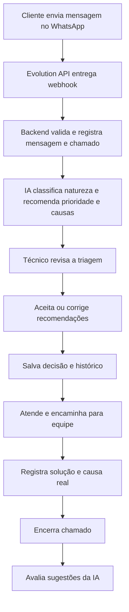

# Mapa de funcionalidades

Análise das cinco telas e dos diagramas de fluxo e arquitetura em `docs`, confrontada com o código atual. As imagens são protótipos com dados fictícios; não demonstram integração funcional. A parte inferior do painel de IA em `tela-2.png` está cortada; os requisitos de aceite/edição vêm do diagrama de fluxo.

## Situação atual

- Backend Spring Boot com PostgreSQL: criação, consulta por ID, listagem paginada, filtros, histórico por telefone, alteração de status, prioridade final, responsável e encerramento com causa real.
- Prioridade sugerida e final são campos separados. A sugerida é recebida na criação; ainda não é produzida por uma IA.
- Encerramento registra data e bloqueia alterações posteriores. Novo chamado pode referenciar o anterior quando o último chamado daquele telefone está encerrado.
- Frontend: diretórios com `.gitkeep`, sem aplicação React implementada.
- IA: `train.py`, `predict.py` e `requirements.txt` vazios; subdiretórios também são placeholders.
- Sem implementação encontrada para Evolution API, mensagens, triagem, avaliação, dashboard ou autenticação.
- `database/schema` e `database/migrations` ainda não contêm scripts. Hibernate usa `ddl-auto=update`.

## Fluxo necessário

A IA recomenda; a decisão final é do técnico. O estado da triagem deve ser separado do estado do atendimento.

## Mapa por módulo

| Módulo / evidência | Funcionalidades necessárias | Situação atual / lacuna |
| --- | --- | --- |
| Dashboard — tela 1 | Contar abertos, críticos, em atendimento e encerrados hoje; mostrar variação de aberturas na última hora | Faltam agregações e interface; definir janela de tempo e fuso |
| Fila — tela 1 | Exibir ID, cliente, resumo, natureza, prioridade, equipe e tempo desde abertura; abrir atendimento | Listagem básica existe; faltam resumo, natureza, equipe e interface |
| Ordenação — tela 1 | Ordenar por severidade da prioridade sugerida e desempatar por tempo de abertura | Paginação e ordenação genérica existem; texto de prioridade não fornece ordem de severidade |
| Distribuição — tela 1 | Contagem por incidente, requisição e dúvida | Natureza não existe no modelo |
| Pendências — telas 1 e 3 | Contar e listar recomendações aguardando decisão; abrir triagem | Falta estado e consulta de triagem |
| Atendimento — tela 2 | Conversa cronológica, remetente, horário, envio de resposta e resultado do envio | Não há entidade de mensagem nem integração WhatsApp |
| Cliente — tela 2 | Nome, telefone, setor, canal, abertura e histórico de chamados navegável | Nome, telefone, abertura e busca por telefone existem; faltam setor, canal e interface |
| Triagem — telas 2 e 3, diagramas | Exibir natureza sugerida, prioridade e hipóteses de causa; aceitar ou editar; registrar autor, data e alterações | Só existem campos de prioridade sugerida/final; falta o restante do processo |
| Encaminhamento — tela 1 e fluxo | Atribuir técnico, encaminhar N1/N2 e acompanhar atendimento | Responsável é texto livre; faltam equipes, identidade do técnico e histórico de encaminhamento |
| Encerramento — tela 4 | Informar causa real e solução aplicada, confirmar encerramento e preservar histórico | Causa real, status e data existem; falta solução aplicada |
| Avaliação — tela 5 | Registrar correta, parcialmente útil ou incorreta; associar à sugestão e ao avaliador | Não implementado |
| Indicadores da IA — tela 5 | Contar triagens avaliadas, sugestões úteis e as que precisam de revisão | Não implementado; definir como “parcialmente útil” entra nos totais |

## Componentes e contratos necessários

| Componente do diagrama | Responsabilidade / entrega |
| --- | --- |
| Evolution API + Webhook Controller | Receber eventos autenticados, identificar mensagem e remetente, normalizar telefone e evitar duplicação por ID externo |
| Mensagem Service | Persistir entrada/saída, relacionar conversa ao chamado, enviar respostas e tratar falhas sem duplicar envios |
| Chamado Service | Expandir dados do chamado e regras de transição; manter vínculo com cliente, mensagens, responsável e equipe |
| Triagem Service + Cliente de IA | Solicitar inferência, persistir resultado e versão, controlar pendência/falha, receber decisão humana e histórico |
| Microsserviço Python | Pré-processar texto; classificar natureza; recomendar prioridade por impacto × urgência; sugerir causas via LLM |
| Histórico de Triagem | Preservar recomendação original, correções, autor, momento e versão de cada decisão |
| Dashboard Service | Produzir contagens e distribuição consistentes com os filtros e regras do negócio |
| PostgreSQL | Persistir chamados, mensagens, triagens, decisões, avaliações e relacionamentos, com migrações versionadas |
| Frontend React | Implementar as cinco telas, navegação e integração com estados de carregamento, vazio, erro e sucesso |

Contratos HTTP a projetar: webhook; leitura/envio de mensagens por chamado; solicitação/consulta de triagem; aceite/correção; avaliação; agregações do dashboard. São propostas de contratos, não endpoints existentes. O provedor de LLM e a forma de disponibilizar o modelo ainda não estão definidos nos arquivos.

## Dados que faltam

- **Chamado:** resumo/descrição, natureza, setor/canal, equipe e solução aplicada. Prioridades precisam de valores padronizados, incluindo `CRITICA`, e ordem explícita de severidade.
- **Mensagem:** identificador externo, direção, remetente, texto, horários, estado de envio e chamado associado. Suporte a anexos não está especificado nas telas.
- **Triagem:** estado, entrada analisada ou referência à entrada, natureza/prioridade/causas sugeridas, impacto, urgência, versão do modelo e momento da análise.
- **Decisão:** valores finais, vínculo com a versão da triagem, técnico, data e registro das alterações. Justificativa é recomendada para rastreabilidade.
- **Avaliação:** sugestão ou conjunto avaliado, categoria de utilidade, técnico e data; comentário é uma extensão recomendada.
- **Técnico/equipe:** identidade, perfil, equipe N1/N2 e vínculo com responsáveis. O texto livre atual não autentica uma pessoa.

## Regras a consolidar antes de implementar

1. Definir quando uma mensagem entra em chamado aberto e quando abre novo chamado; o código atual permite criar vários chamados abertos para o mesmo telefone.
2. Separar status do chamado (`ABERTO`, `EM_ATENDIMENTO`, `AGUARDANDO_USUARIO`, `ENCERRADO`) do status da triagem. Estados propostos: pendente, processando, aguardando revisão, validada e falhou.
3. Definir natureza e prioridade finais, mantendo sugestões originais para comparação. Especificar a matriz impacto × urgência e o papel do técnico ao corrigi-la.
4. Definir qual prioridade governa a fila depois da revisão humana: a tela fala em sugerida, mas a decisão final deve ter uma regra explícita.
5. Registrar solução aplicada junto da causa real. Definir campos obrigatórios e quem pode encerrar.
6. Registrar avaliação em entidade separada: chamado encerrado é imutável no serviço atual, mas o fluxo pede avaliação posterior.
7. Definir se a avaliação é por hipótese de causa ou pelo conjunto de sugestões; estabelecer os cálculos dos indicadores.
8. Definir atualização da interface (consulta periódica, SSE ou WebSocket). Nenhuma dessas tecnologias é exigida pelas imagens.
9. Definir fuso, período e escopo dos indicadores, incluindo o significado de “abertos” frente a “em atendimento”.

## Requisitos transversais recomendados

Estes pontos são necessários à operação com dados reais, mas não aparecem integralmente nas telas:

- Autenticação de técnicos e autorização por perfil/equipe; autenticação e validação do webhook.
- Idempotência de eventos, tratamento de eventos fora de ordem e reenvio controlado de mensagens.
- Falha da IA não bloquear atendimento manual; timeout e opção de nova tentativa com rastreabilidade.
- Validação de entradas, mensagens de erro consistentes e proteção contra atualizações concorrentes da triagem.
- Minimizar dados pessoais enviados ao LLM e definir retenção, acesso e anonimização de conversas e datasets.
- Guardar chaves da Evolution API/LLM fora do repositório; logs sem conversas completas ou credenciais.
- Registrar versão de modelo/prompt e separar treino, validação e teste para medir qualidade sem vazamento entre conjuntos.

## Ordem sugerida de implementação

| Etapa | Entregas | Evidência de conclusão |
| --- | --- | --- |
| 1. Base do domínio | Campos ausentes, categorias, equipes/técnicos, migrações e proteção de acesso | Chamado completo pode ser criado, atribuído e encerrado com causa e solução |
| 2. Atendimento | Webhook, mensagens, Evolution API e tela 2 | Evento duplicado não duplica mensagem; resposta chega ao cliente; histórico é preservado |
| 3. Triagem assistida | Serviço Python, contrato com Java, aceite/correção e telas 2–3 | Recomendação original e decisão humana persistem; atendimento continua se IA falhar |
| 4. Encerramento e avaliação | Telas 4–5, avaliação após encerramento e indicadores de utilidade | Chamado encerrado preserva dados e aceita avaliação vinculada à sugestão correta |
| 5. Dashboard | Tela 1, métricas, distribuição e fila ordenada | Indicadores conferem com registros persistidos e filtros; ordenação respeita severidade |

Implementar a interface junto de cada etapa. As verificações acima são critérios propostos; esta análise não executou nem implementou esses novos fluxos.
